# UX exemplars — a pattern library from sites that feel good

#claude 2026-10-23, from a live read of public pages (logged out, no cookie consent given).
Rules referenced: [ux-principles.md](ux-principles.md) (Goals 1–4, Rules 1–6, status vocabulary).
Journeys referenced: [plans/v1-journeys.md](plans/v1-journeys.md) (J1 find-or-add, J2 understand,
J3 fix-and-promote). Screenshots: [ux-exemplars/](ux-exemplars/).

**Why this exists:** UX decisions should cite a concrete example, not a vibe. Every pattern below
names where it was seen, which rule it serves, which journey uses it, and what it costs in
Streamlit vs React. That last column also feeds the pending SPCS/React spike decision.

## The two sides of the Workbench (#chris, 2026-10-23)

#chris's framing, mid-study: the Workbench is **two-sided**.

1. **Explore:** a dictionary you navigate, with visual interest. Search, browse, read, and
   understand at a glance (J1 find, J2).
2. **Edit:** write, save, validate, inspect, *and feel like you achieved something* (J1 add, J3).

Lolalytics, Letterboxd and BeerAdvocate are explore-side. Stripe is a read-side bridge (a
definition next to its code). Wikipedia, GitHub and Linear (added in a second pass) cover the
edit side: P15–P22.

## Sites and the job each exemplifies

| Site | Page(s) studied | Job | Feel in one line |
|---|---|---|---|
| **Lolalytics** (#chris pick) | `/lol/heimerdinger/build/`, `/lol/tierlist/` | Stats/tables · click-to-filter · search | Every number is clickable and scoped; the page reads like a sentence first |
| **BeerAdvocate** (#chris pick) | `/beer/top-rated/`, `/beer/profile/23222/78820/`, `/search/?q=stout` | Entity detail · ratings/consensus · contribution | Old-school but trustworthy: score, sample size, spread, and who said what |
| **Letterboxd** | `/film/parasite-2019/`, `/films/popular/this/week/genre/thriller/` | Browse/filter · entity detail · look and feel | Calm slate palette, prose serif, quiet chrome; content is the page |
| **Stripe API docs** | `/api/subscriptions/object` | Definition beside code · navigation · search palette | The definition and its code are always on screen together |
| **Wikipedia** | `Churn_rate` with `?veaction=edit`, `?action=history`, `?diff=prev&oldid=…` | Writing/editing · history · diff | Editing looks like reading; every change has who, when, size and why |
| **GitHub** (logged out) | `dbt-labs/jaffle-shop` `models/marts/orders.sql`, code and blame views | Code provenance · disabled-with-reason | Every line of SQL knows who changed it and why |
| **Linear** (public docs + homepage demo) | `/docs/creating-issues`, `/docs/editor`, `linear.app` | Create and edit fast · activity feed | Keyboard-first creation; human and machine changes in one calm timeline |
| ~~dbt docs~~ | — | Domain analog | **Not studied:** GitLab's public dbt docs now sit behind a bot check and sign-in; dbt's MRR playbook demo returns 404. |

Third pass, from Astra's brief (its "focused first pass" list, minus Linear, which was already done):

| Site | Page(s) studied | Job | Feel in one line |
|---|---|---|---|
| **Scryfall** | `/search?q=t:goblin c:r mv<=2`, a malformed query, `/card/msc/806/lightning-bolt` | Expert discovery · one entity, many implementations | Power-user syntax, but it always tells you in English what it understood |
| **regex101** | `/` (typed a pattern + test strings, then broke it) | Precise input with live feedback | The check says exactly what it established, and errors point at the token |
| **Sanity** (docs; the Studio needs a sign-in) | `/docs/content-lake/drafts-and-versions` | Draft vs published lifecycle | Published stays intact while one draft holds your edits |

Edit-side caveat: I couldn't type in any of the editors. Wikipedia's editor opens but blocks
this IP range from publishing. GitHub's editor and the Linear app need a sign-in. So save,
commit and draft behavior come from what the pages show plus Linear's own docs, and I mark
anything I didn't observe directly.

---

## Patterns

Cost key: **S** = small (a day or less), **M** = a few days, **L** = fights the framework or
can't be done well. *Streamlit* means stock Streamlit plus light CSS; *React* means the SPCS spike stack.

### Explore side

#### P1 · Search suggestions after two keystrokes, with deep links per result
- **Seen:** Lolalytics header search. Typing `he` instantly shows grouped results
  (*Champion Builds*, then *Summoner Profile*). Each result row carries its own sub-actions
  (**Leaderboard · Counters · Pro Builds**) that jump straight to a tab of that entity. On a
  champion page it also offers "Heimerdinger **vs** X" matchups. Matching is substring-anywhere
  (`he` → Hecarim, As**he**, S**he**n). Stripe does the same as a `/`-triggered modal palette:
  title, a breadcrumb (*Billing › Subscriptions*), the first line of the description, and a
  keyboard footer (`↑↓ Navigate · ↵ Go`).
  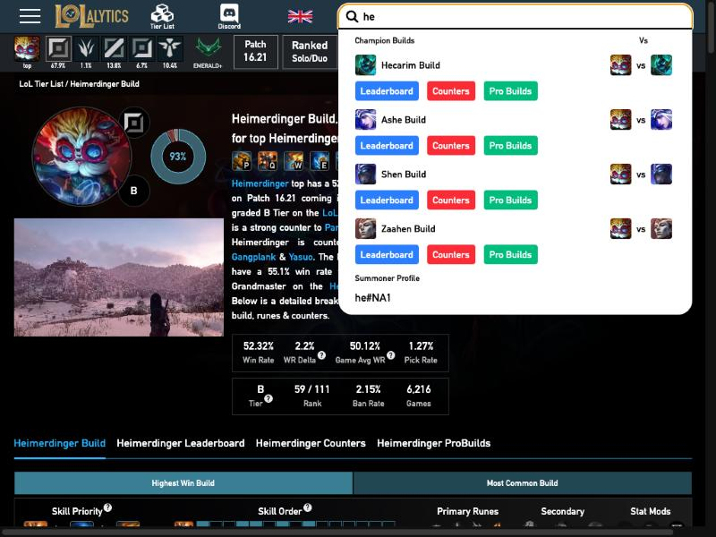
- **Why it works:** Goal 2 (fast: no results page, no Enter). Goal 1 (the next step sits on
  the result itself). Showing a description line and breadcrumb lets you recognize a match
  without opening it, which is exactly J1 Q2.
- **Workbench:** J1. Each suggestion shows name · department · `Candidate`/`Canon` pill ·
  `✓ Validated` · first description line. Sub-actions: **Open · View SQL · Edit**. The last
  row is always **Create "<query>"** (our empty-state rule, folded into the dropdown). `/` or
  ⌘K opens it from anywhere.
- **Cost:** Streamlit **M–L**. Search-as-you-type exists (unmerged), but a dropdown overlay
  with per-row actions and arrow-key navigation needs a custom component. React **S**
  (cmdk or similar).

#### P2 · Click any value to filter the page in place, and put the filter in the URL
- **Seen:** Lolalytics. Clicking the *middle* lane chip re-scopes the whole page with no full
  reload: URL → `?lane=middle`, title → "…for **middle** Heimerdinger", the summary sentence
  and every stat recompute. Item and rune tables say *"Click Items Below to Filter Builds by
  Item"*. Tier-list lane filters are plain links (`/lol/tierlist/?lane=middle`). Letterboxd
  encodes filters in the path (`/films/popular/this/week/genre/thriller/`).
- **Why it works:** Goal 2 (one click). Rule 1 (orientation): the filter state is in the
  title, the URL and the prose, so you always know what you're looking at. Filtered views can
  be shared as links.
- **Workbench:** J1/J2 list. Click a department pill, a status pill or an author on any row
  to filter by it. `?dept=finance&status=canon` makes "all canon Finance metrics" a link
  #chris can paste in Slack.
- **Cost:** Streamlit **S–M** (`st.query_params` works; making every value clickable is
  awkward). React **S**.

#### P3 · Facets that show their own size
- **Seen:** Lolalytics lane bar: each lane icon carries its share of games (top 67.9% · mid
  13.8% · …), plus a 93% ring on the portrait. Letterboxd's filter result is a sentence:
  *"There are 65,908 thrillers."*
- **Why it works:** Goal 3. You know whether a filter is worth clicking before you click it,
  and the result count confirms what the filter did.
- **Workbench:** J1 list. `Finance 42 · Marketing 7 · Sales 3`. Above results:
  *"12 Finance metrics · 4 canon."*
- **Cost:** Streamlit **S**. React **S**.

#### P4 · A one-sentence summary above the stats
- **Seen:** Lolalytics opens every champion page with generated prose: *"Heimerdinger top has
  a 52.32% win rate … rank 59 of 111 … graded B Tier … strong counter to Pantheon, Urgot &
  Kled…"*. Every noun in it is a link. The stat grid comes after the sentence.
- **Why it works:** Goal 3. The sentence states the conclusion and the grid backs it up, and
  each stat has a `?` tooltip that defines it.
- **Workbench:** J2 metric page header. *"Net New ARR is a **canon** Finance metric, validated
  on rev 4 (2 days ago). Used by 3 Looker reports."* It can be templated; no LLM needed. The
  `?` tooltips map to our glossary terms (`Candidate`, `Canon`, `Validated`).
- **Cost:** Streamlit **S**. React **S**.

#### P5 · Sample size next to every number
- **Seen:** Lolalytics shows `win rate` over `games` on every cell (*56.56% · 1,775*), and
  rank as *59 / 111*. BeerAdvocate shows *AVG 4.83 · pDev 7.25%*, *RATINGS 965 · 194 reviews*,
  and its list says *"Sorted by weighted rank (not shown)"*.
- **Why it works:** Goal 3 and trust. Matches the project rule "always report `n` alongside
  accuracy". A 60% from 27 games and a 52% from 6,216 games are visibly different claims.
- **Workbench:** Later (usage and eval columns), but set the convention now: any count or
  rate shows its denominator. *"Answered 14 questions · 86% thumbs-up (n=14)."*
- **Cost:** Streamlit **S**. React **S**.

#### P6 · Skeleton grid while loading
- **Seen:** Letterboxd browse renders the full poster grid as empty outlined tiles, with the
  filter bar and result sentence already in place, then fills them in.
  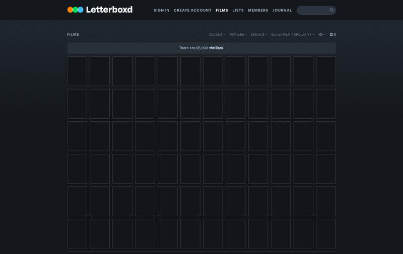
- **Why it works:** Goal 2 (it feels instant), and the layout doesn't jump. The waiting state
  is designed, which is one of the five states the contract process requires.
- **Workbench:** list first load, and the validation preview (`Validating…` shows a 10-row
  skeleton table).
- **Cost:** Streamlit **M**. `st.spinner` is the stock answer; true skeletons need
  placeholders and CSS, and reruns flash. React **S**.

#### P7 · Quiet filter bar as inline text dropdowns
- **Seen:** Letterboxd: `DECADE ˅  THRILLER ˅  SERVICE ˅  Sort by FILM POPULARITY ˅` as
  small caps in one line on the right of the section header. There are no boxes, and the active
  value replaces the label.
- **Why it works:** "Content first" and "Restraint". The controls recede until you want them.
- **Workbench:** list header. `DEPARTMENT ˅  STATUS ˅  Sort by RECENTLY CHANGED ˅`.
- **Cost:** Streamlit **M** (stock selectboxes are boxed and labelled; restyling them is
  fragile). React **S**.

### Entity page (the hinge between the two sides)

#### P8 · Definition and code side by side, code pane sticky
- **Seen:** Stripe API reference. Left column: attributes, each with name · `type` badge ·
  one-line definition, and nested fields behind **Show child attributes**. Right column:
  the object's JSON, in a sticky aside (`position: sticky`) that stays in view as you scroll
  the definitions. Header actions: **Ask about this section · Copy for LLM · View as
  Markdown**, plus a version selector.
  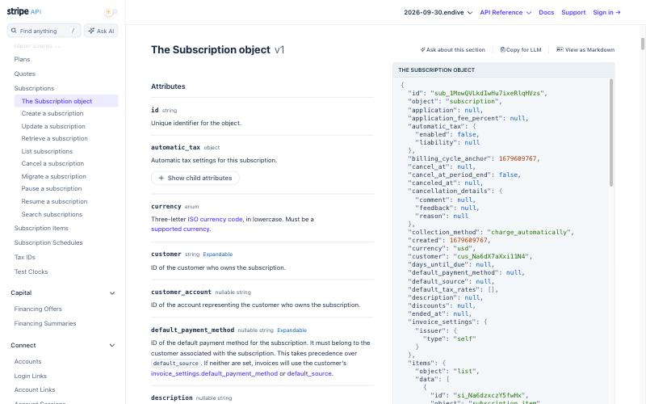
- **Why it works:** Goal 3. The definition and its implementation are one glance apart, never
  a tab apart. "Content first": the page is the definition and the code.
- **Workbench:** J2/J3, and it settles the "SQL on the metric page" layout. Left: description,
  when to use, readiness. Right: sticky SQL card with the validation state and preview beneath.
  **Copy for LLM** is a natural fit (the Oracle is the consumer) and nearly free.
- **Cost:** Streamlit **M** (`st.columns` works; sticky right column needs CSS hacks that
  break on rerun). React **S**.

#### P9 · Score with a word, status pill, and a quiet meta line
- **Seen:** BeerAdvocate: a big **100** badge labelled *BA SCORE · World-Class*, the style
  link, *12% ABV*, a small green **Active** pill. Below it, one muted line:
  *"Suggest edit · Last rated Oct 16, 2026 · Shelf talker"*. Further down: *"Beer added
  Feb 26, 2012"*.
  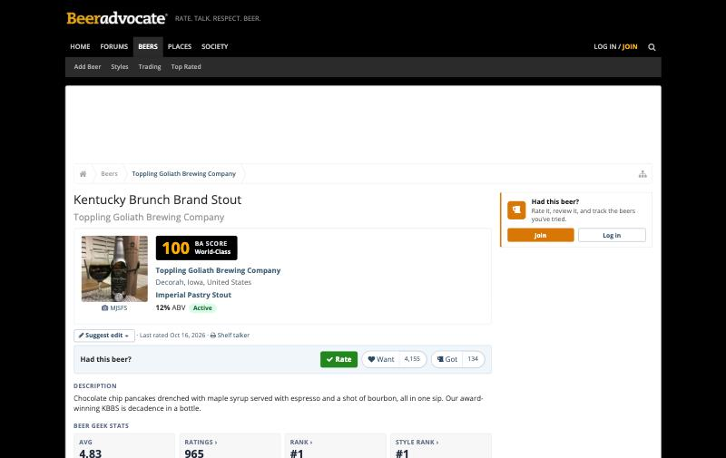
- **Why it works:** Rule 3 in practice. Score (quality), *Active* (lifecycle) and *last rated*
  (freshness) are three different things in three different places and styles. Goal 1: the
  contribution action (*Suggest edit*) is always visible but never loud.
- **Workbench:** J2/J3 header. `Canon` pill (knowledge) · `✓ Validated` next to the SQL
  (validation) · `✓ Saved · rev 4` on the right (save). Meta line:
  *"Edit · Last validated 2 days ago · Added Oct 3 by Gabe"*.
- **Cost:** Streamlit **S**. React **S**.

#### P10 · Each contribution shown against the consensus
- **Seen:** BeerAdvocate reviews: every rating shows **rDev** (deviation from the beer's
  average, e.g. *rDev −29%*), plus a 1–5 rating-spread histogram. Letterboxd shows a ratings
  histogram and splits reviews into **Popular** and **Recent**.
- **Why it works:** Goal 3. You see agreement and outliers at a glance, without reading
  every entry.
- **Workbench:** V2 adjudication. Competing SQL implementations show their deviation from
  the canon result (*"returns 3.1% higher than canon for Sep"*). For V1, "Recent" ordering is
  enough for the history rail.
- **Cost:** Streamlit **S** (a bar chart). React **S**.

#### P11 · Secondary facts in tabs under the summary
- **Seen:** Letterboxd film page: synopsis first (in a serif), then a `CAST · CREW · DETAILS ·
  GENRES · RELEASES` tab strip in small caps. Lolalytics: `Build · Leaderboard · Counters ·
  ProBuilds` tabs under the stat block.
- **Why it works:** "Content first"; the long tail is one click away rather than stacked.
- **Workbench:** J2. Under the definition and SQL: `HISTORY · USED BY · RELATED · DETAILS`.
  V1 needs only History and Details.
- **Cost:** Streamlit **S** (`st.tabs`). React **S**.

### Look and feel

#### P12 · Cool slate dark palette, serif for prose, sans for UI
- **Seen:** Letterboxd: background `#14181c`, body text `#99aabb` (blue-grey), headings white,
  UI in Graphik (sans), synopsis and reviews in Tiempos (serif), tiny small-caps section
  labels. Stripe (light): `#f4f7fa` background, `#3c4257` text, system UI at 14px, Source Code
  Pro for code.
- **Why it works:** "Restraint", "cool slate neutrals with one cool accent". Letterboxd is
  almost #chris's palette as-is. A serif for the *definition* prose separates "knowledge" from
  "interface" without color.
- **Workbench:** adopt the slate scale. Consider a serif (or Inter at text optical size) for
  description and when-to-use, sans for chrome, mono for SQL. Ship light and dark from day one.
- **Cost:** Streamlit **M** (theme config covers colors; the type pairing and small caps need
  CSS injection). React **S**.

### Edit side and progress

#### P13 · Personal progress against a collection
- **Seen:** BeerAdvocate Top 250: *"✔ You rated 0 beers on this list. Log in to begin your
  beer adventure."* Lolalytics header: *"Emerald+ Champions Analysed: 4,925,020"*, a live
  corpus counter on every page.
  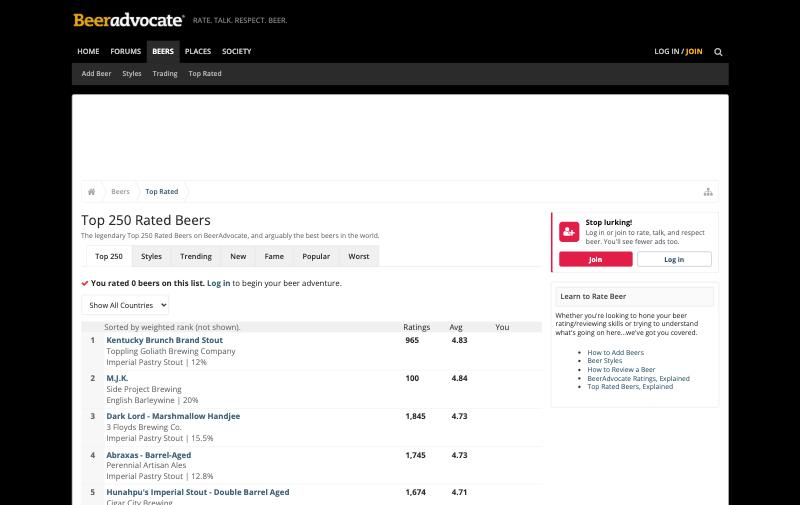
- **Why it works:** Goal 4 (fun) and #chris's "feeling like you're achieving something".
  The collection has a size, and you have a place in it.
- **Workbench:** #chris's ideas fit this pattern directly. A header strip like
  *"Finance: 42 metrics · 18 canon · avg freshness 9 days · ~31% of Looker Finance reports
  covered"*. After a save or promote, the relevant number ticks up with a brief highlight
  (calm motion). On the list: *"You've added 6 metrics this month."*
- **Cost:** Streamlit **S** for the numbers; **M** for an animated tick, which reruns fight.
  React **S**.

#### P14 · Agent-facing affordances on a human page
- **Seen:** Stripe: **Copy for LLM**, **View as Markdown**, **Ask about this section**.
- **Why it works:** the page's second reader is a machine, and Stripe says so openly.
- **Workbench:** the dictionary's real consumer is the Oracle. **Copy for LLM** (the exact
  serving payload for this metric) shows the SME what the agent will see, which also builds
  trust. Later: **Ask the Oracle about this metric** (cost-gated per CLAUDE.md).
- **Cost:** Streamlit **S**. React **S**.

### Edit side (second pass: Wikipedia, GitHub, Linear)

#### P15 · Editing looks like reading
- **Seen:** Wikipedia's visual editor opens *in place*. Same title, same typography, same
  layout. A slim toolbar appears under the `Read · Edit · View history` tabs, a *Short
  description* slot appears above the body, and **Publish changes…** sits top-right, greyed
  out until something changes. Linear's editor turns Markdown into rich text as you type
  (`**bold**`, `#` heading, `/` commands) with no separate preview.
  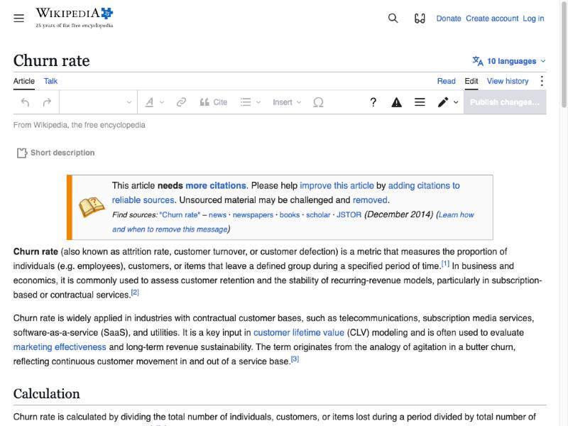
- **Why it works:** Rule 1. You can tell you're editing (the tab, the toolbar), yet you're
  still looking at the page as readers will see it, so there's no form-vs-page mental switch.
  Rule 5: the one primary action is visible and disabled until it means something.
- **Workbench:** J1/J3, and it answers **D1** (view mode + Edit). Edit mode keeps the page
  layout and turns the fields editable in place, rather than swapping to a form. ⌘E toggles
  it. The Save button sits in the sticky header, disabled until dirty.
- **Cost:** Streamlit **L** (inputs look like inputs; in-place editing means a custom
  component). React **M** (contenteditable or a Tiptap-style editor; the SQL uses Monaco or
  CodeMirror).

#### P16 · The save asks "why?" (an edit summary)
- **Seen:** Wikipedia's button is **Publish changes…**, where the ellipsis means a dialog
  follows (the edit summary; I couldn't open it while blocked). Every history row then carries
  that summary: *"I realised that 'e.g.' was better / less ambiguous wording."*, or the honest
  fallback *"No edit summary"*. GitHub shows the last commit message above every file:
  *"Update project structure (#25)"*. (GitHub's commit dialog itself needs a sign-in; not seen.)
- **Why it works:** Goal 3 and trust. History stops being a list of timestamps and becomes
  a list of reasons, and the next editor learns *why* the SQL looks the way it does.
- **Workbench:** J3, plus the history rail (HIST-01/02). Add an optional one-line "What
  changed?" next to Save. It's required only when promoting or editing a canon metric.
  Blank shows *"No summary"*. Keep it to one field, never a form.
- **Cost:** Streamlit **S**. React **S**.

#### P17 · History rows: who · when · size of change · why · undo
- **Seen:** Wikipedia history: each row is *date · user · bytes after · **+31** / **−397**
  (green/red) · summary · undo · tags* (*Visual edit*, *Mobile edit*, *Newcomer task*,
  *Suggested: add links*). Bot edits are listed as plainly as human ones (*PrimeBOT*,
  *CutlassBot*). **undo** "reverts this edit and opens the edit form in preview mode", so it's
  never instant or destructive.
- **Why it works:** Rule 4 (recovery is one click, and it goes through a preview rather than
  a silent revert). The size delta tells you at a glance which edits matter.
- **Workbench:** J2 history rail. `rev 4 · Gabe · 2 days ago · SQL +3 lines · "exclude test
  accounts" · Restore…`. **Restore** opens the editor prefilled with the old revision; the user
  then saves it as a new revision. Tags show the source: `human`, `import`, and in V2
  `machine`.
- **Cost:** Streamlit **S–M**. React **S**.

#### P18 · Side-by-side diff with who/when/why headers
- **Seen:** Wikipedia diff. Two columns, each headed *"Revision as of 10:17, 19 May 2026
  (edit) (undo)"* · author · summary · tags, with **← Previous edit / Next edit →**. Changed
  words are highlighted inside the line. A **Visual / Wikitext** toggle and an **Inline**
  switch change the view.
  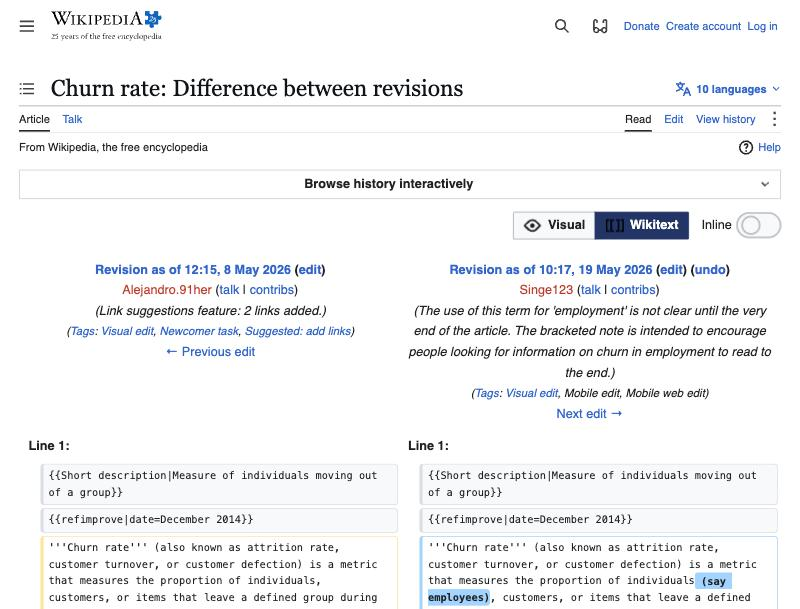
- **Why it works:** Goal 3. Prev/next lets you walk the history one change at a time.
- **Workbench:** J3, plus the conflict pattern (*"Gabe saved a newer version… Changed: SQL,
  description"* → **View theirs** opens this diff). Diff the SQL and the description separately;
  where both revisions were validated, a *result* diff (row-count or value change) is the
  BI-specific bonus.
- **Cost:** Streamlit **M** (difflib to HTML works; word-level highlighting and the toggles
  take effort). React **S–M** (Monaco diff editor).

#### P19 · Line-level provenance (blame) with an age heat strip
- **Seen:** GitHub's code view has a byline above the file (*avatar · gwenwindflower · Update
  project structure (#25) · b232e30 · 2 years ago · History*) and *"77 lines (53 loc) · 1.42
  KB"*. The **Blame** toggle annotates each block with age, author and commit message
  (*"Fix fanout in customers model…"*), plus an **Older ▮▮▮▮ Newer** heat legend and a
  contributor count.
  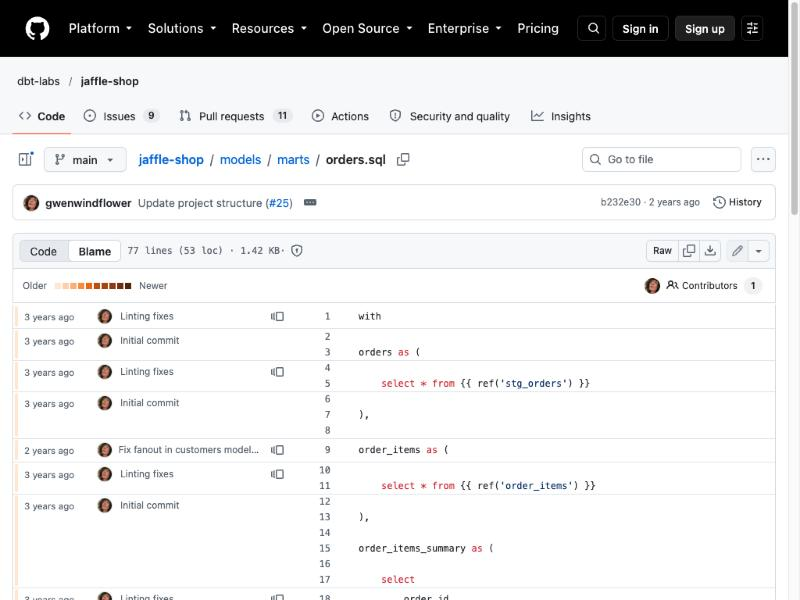
- **Why it works:** Goal 3 and trust. "Why is this `WHERE` clause here?" gets answered in
  place, which is exactly the forensic question BI asks about inherited SQL.
- **Workbench:** J2. A byline above the SQL card (*"Last changed by Gabe · 'exclude test
  accounts' · 2 days ago · History"*) adopts now. A blame toggle on the SQL comes later (it
  needs line-level revision mapping).
- **Cost:** byline: Streamlit **S**, React **S**. Blame: Streamlit **L**, React **M**.

#### P20 · Disabled action with the reason in a tooltip
- **Seen:** GitHub logged out: the pencil is visible but greyed, and hovering says *"You must
  be signed in to make or propose changes"*. Note the wording: **propose** changes is the
  path for people without write access (a fork and pull request).
- **Why it works:** exactly the existing "Disabled actions" rule. It also shows a two-tier
  model: some people *make* changes and others *propose* them.
- **Workbench:** J3. **Promote** is disabled with *"Needs: When to use · ✓ validated SQL"*.
  For V2, "propose" maps to editing a canon metric as a suggestion (a candidate revision) that
  an owner accepts, so canon is never casually overwritten.
- **Cost:** Streamlit **S** (the `help=` tooltip on buttons). React **S**.

#### P21 · Create from anywhere: shortcut, prefilled URL, and a quiet grace window
- **Seen (Linear docs):** **C** opens the create modal from anywhere. **Create issue from
  selection** turns highlighted text into an issue. `linear.new?title=…&status=…&assignee=me`
  pre-fills a new issue from a URL, so other tools can link straight into creation. And:
  *"Changes made to an issue's properties in the first 3 minutes are considered part of the
  issue creation process, and won't be added to the activity log."*
- **Why it works:** Goal 2. The grace window keeps history meaningful, because fixing a typo
  right after creating doesn't spawn rev 2, rev 3 and rev 4.
- **Workbench:** J1. `/new?name=Net+New+ARR&dept=finance` lets **the Oracle** link a
  prefilled *"Create this metric"* whenever it can't find one (a coverage loop), and the
  same link works from Slack. **C** or **N** on the list opens a new metric. Successive saves
  by the creator within a few minutes fold into one revision.
- **Cost:** Streamlit **S** for the URL prefill (`st.query_params`), **M** for keyboard
  shortcuts. The grace window is backend logic, and the same cost in either. React **S**.

#### P22 · One timeline for human and machine changes
- **Seen:** Linear homepage demo issue. The Activity feed mixes quiet one-liners (*"Linear
  created the issue via Slack on behalf of Karri · 2min ago"*, *"Triage Intelligence added the
  labels Performance and iOS"*, *"Linear moved from Todo to In Progress · just now"*) with
  comment cards from people. Machine actors are named and attributed like people, in muted
  text. The editor docs add: *"Referenced issues are added as related issues automatically"*
  via `@ENG-123`.
  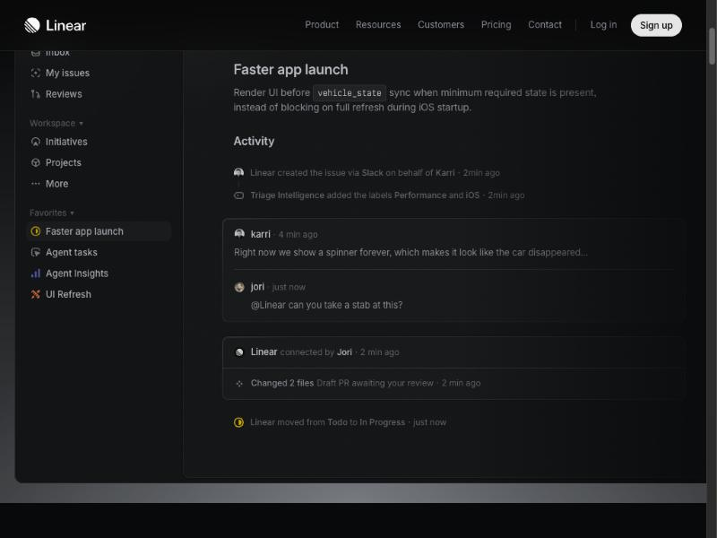
- **Why it works:** Rule 1 and trust. You can always tell what a person did from what a
  machine did, without a separate log. Events are quiet; comments get a card.
- **Workbench:** J2 history, and the V2 bridge. *"Forensics proposed this SQL from 3 Looker
  explores · 5 days ago"*, *"Validation passed on rev 4"*, *"Chris promoted to Canon"* in one
  feed. `@metric` mentions in a description auto-link related metrics (a cheap start on "related").
- **Cost:** Streamlit **S–M**. React **S**.

### Discovery and feedback (third pass: Scryfall, regex101, Sanity)

#### P23 · The search repeats your query back in plain English
- **Seen:** Scryfall. `t:goblin c:r mv<=2` returns *"1 – 60 of 245 cards where the card types
  include "goblin" and the colors ≥ R and the mana value <= 2"*. A malformed query still runs
  the valid part and says what it dropped: *"0 cards found where the card types include
  "gobln" · Invalid expression "foo:bar" was ignored. Unknown keyword "foo"."* The empty state
  then offers **Go Back · Syntax Guide · Advanced Search**. View (*Images / Checklist / Text*)
  and sort are dropdowns written as a sentence: *Cards **as** Images **sorted by** EDHREC
  Rank*. All of it lives in the URL.
  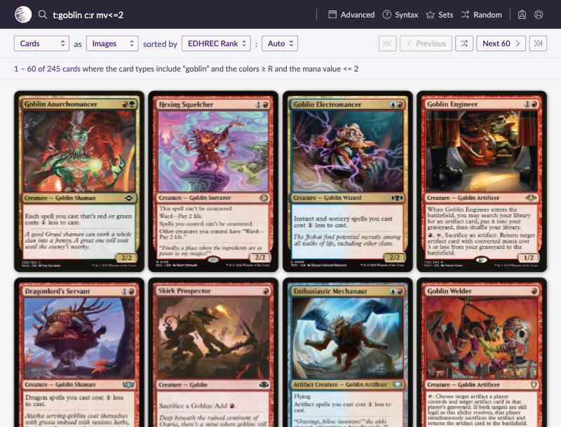
- **Why it works:** Rule 6 and Goal 3. Experts get terse syntax and novices get a sentence.
  Nothing is silently ignored, which fixes the classic "why are there no results?".
- **Workbench:** J1 list. *"12 metrics in Finance, canon only, matching "arr"."* Each clause
  is clickable to remove it (pairs with P2/P3). Zero results gives that sentence plus
  **Create "arr"** · **Clear filters**. Elaborate query syntax is later (Astra agrees); the
  echo sentence is now.
- **Cost:** Streamlit **S**. React **S**.

#### P24 · One concept, many implementations, with the current one highlighted
- **Seen:** the Scryfall card page. The card's text and rules sit in the middle. The right rail
  lists **Prints** (every printing, with prices) and **Faces, tokens & other parts**, with the
  one you're viewing highlighted and **View all prints →** below. A **legality grid** gives one
  status chip per format (`LEGAL` / `NOT LEGAL` / `BANNED`). Utility links: *Copy-pasteable
  JSON · Report card issue*.
  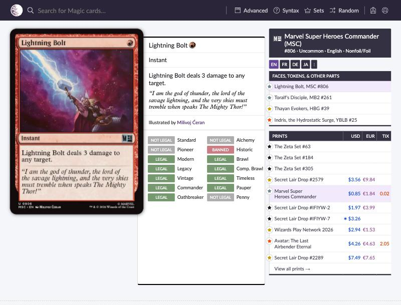
- **Why it works:** Goal 3. The concept (the card) and its implementations (the prints) are
  one page with a compact switcher, not separate screens. That's Astra's "a metric and its
  implementations may belong in the same working context even if stored separately". The
  legality grid shows status per context without a paragraph.
- **Workbench:** J2/J3. The SQL card lists implementations compactly (*"Snowflake · canon ·
  ✓ ran rev 4"*, *"Looker-derived · candidate"*), the selected one highlighted, and the
  editor shows it. Later, a per-context grid (*Finance: canon · Marketing: not used ·
  Oracle: served*) is the legality-grid analog. *Report an issue* is the cheapest SME
  contribution path there is.
- **Cost:** Streamlit **S–M**. React **S**.

#### P25 · The check says exactly what it established
- **Seen:** regex101. While evaluating, a small badge reads **Processing…**. When it
  finishes: **3 matches · 56 steps · 38.3 ms**, and the test-input tab gains a ✓. Named groups
  are color-linked across the pattern, the test text and the Match Information table
  (*Group metric 0–3 ARR · Group month 4–11 2026-09*). Empty panels explain what will appear:
  *"Detailed match information will be displayed here automatically."*
  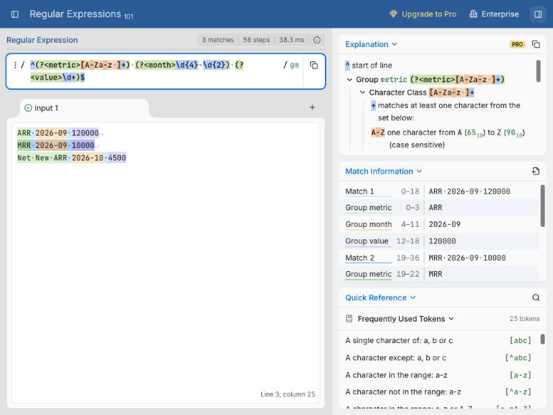
- **Why it works:** Rule 3 and trust. "Passed" is replaced by *what* passed, measured. That's
  Astra's sharpest point: *"Syntax check passed; business correctness has not been reviewed."*
- **Workbench:** J1/J3 validation. Replace bare `✓ Validated` with what actually ran:
  `✓ Runs on Snowflake · 10-row preview · 1.4 s · rev 4`. Business correctness is a separate,
  human, later state (*"Not yet reviewed against a known number"*). See the vocabulary change
  in the principles section.
- **Cost:** Streamlit **S**. React **S**.

#### P26 · An error points at the exact spot and leaves your work intact
- **Seen:** regex101. Adding a stray `(` immediately shows a **Pattern Error** badge, a red
  marker on the offending token, the explanation *"Group is incomplete"*, an error icon on the
  test-input tab, *"The regular expression contains one or more errors"* in the match panel,
  and completion suggestions at the cursor. The test strings are untouched.
  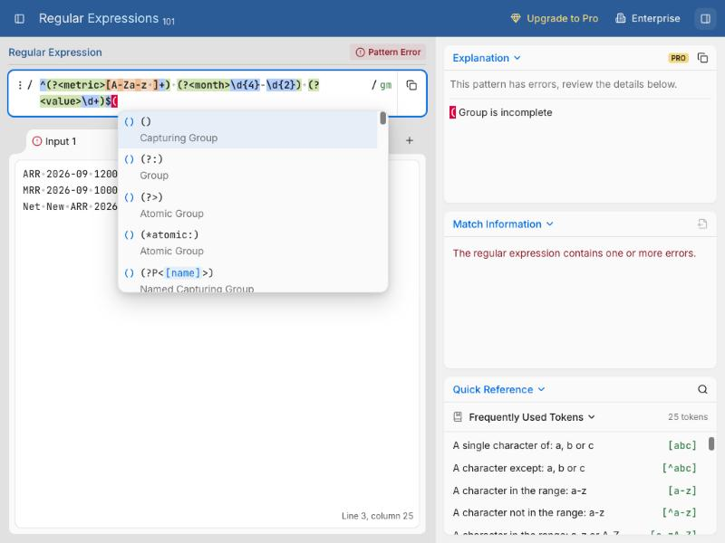
- **Why it works:** Rule 6 (plain errors) and Rule 4 (nothing lost). The error appears where
  your eyes already are.
- **Workbench:** J1/J3 `✗ SQL failed`. Map Snowflake's `line N, position M` to a marker in the
  SQL editor; show the message under the editor; keep the last good preview greyed and
  labelled *"from rev 3"* rather than blanking it.
- **Cost:** Streamlit **L** (no editor gutter markers without a custom component). React
  **S–M** (Monaco/CodeMirror diagnostics).

#### P27 · Explanation and test inputs beside the input
- **Seen:** regex101. The right column holds an **Explanation** tree that rebuilds as you type
  (*"^ start of line · Group metric … · A-Z one character from A to Z"*). Test strings live in
  tabs (**Input 1 · +**), each with its own pass/fail icon.
- **Why it works:** you see the machine's reading of your input next to the input. Astra calls
  regex101 "the strongest conceptual reference for future authoring assistance".
- **Workbench:** later, as Astra's **AI interpretation preview**: beside the definition, the
  Oracle's paraphrase plus *"questions this should answer"* / *"should not answer"* as test
  tabs, each with a ✓/✗ from an actual Oracle run (cost-gated). It's tied to the revision and
  goes stale on edit. V1: none; keep space in the layout.
- **Cost:** Streamlit **M**. React **M** (the cost is the Oracle calls, not the UI).

#### P28 · Published stays intact while a single draft holds your edits
- **Seen (Sanity docs, including a Studio screenshot inside the docs):** a document is
  *Published*, *Draft* or *Version*. *"A document has at most one draft"*. Editing a published
  document creates a draft, and *"the published document stays intact until you roll the
  changes out"*. Production reads the **published perspective** only. In the Studio screenshot
  the header shows `PUBLISHED` (filled) and `DRAFT` (outlined) chips side by side, *"Updated
  1m ago"*, and a separate **✓ Synced** at top right. The context menu has *Browse history*,
  *Inspect* (with keyboard shortcuts), and *Delete…* in red, last. The docs also warn that
  `_updatedAt` changes on *any* write, so they advise an explicit `publishedAt` field.
  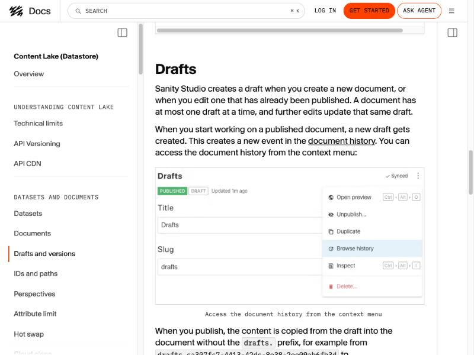
- **Why it works:** Rule 3, cleanly. Lifecycle (`PUBLISHED`/`DRAFT`), save (`✓ Synced`) and
  time (`Updated 1m ago`) are three separate signals. Editing something live is safe by
  construction.
- **Workbench:** J3, LIFE-03 (editing canon). Editing a canon metric creates **one pending
  revision**. The header reads `Canon` + `Revision pending`, and the Oracle keeps serving the
  last canon until the revision is promoted. Pairs with GitHub's "make or propose" (P20). The
  timestamp lesson also applies to #chris's "average freshness" (P13): freshness needs its
  own `last_validated_at` / `promoted_at`, never a generic updated-at.
- **Cost:** UI: Streamlit **S**, React **S**. The real cost is the data model (a revision
  table with a pending pointer). It's a separate decision, not V1 scope unless LIFE-03 pulls it in.

### Anti-patterns observed

- **Full-page search with a 10-result cap** (BeerAdvocate `/search`: ~675 ms to first byte,
  *"Results limited to 10 results. Log in or Join for more"*). Slow and gated. P1 is the fix.
- **Ads and banners competing with content** (all three consumer sites). Our version is
  stacked Streamlit banners; ux-principles already bans it.
- **Every pixel is data** (lower half of Lolalytics: dozens of tables). Right for a dashboard,
  too much for a dictionary page. Take the *interaction* (P2) and the *summary sentence* (P4),
  not the density.
- **Garish 404** (Lolalytics: a blue box on black). dbt's *"DAG! That wasn't supposed to
  happen"* with a single **Go Home** button is the better model for Rule 6.

---

## Adopt now / adopt with React / skip

| Pattern | Verdict | Note |
|---|---|---|
| P3 Facet counts · P4 Summary sentence · P5 `n` beside numbers · P9 Three-status header · P11 Tabs · P14 Copy for LLM | **Adopt now** | Cheap in either stack; pure content decisions |
| P2 Filters in URL | **Adopt now (partial)** | Query params now; click-any-value later |
| P13 Progress strip | **Adopt now (static)** | Numbers now; animated tick with React |
| P1 Suggest-as-you-type with row actions + ⌘K | **Adopt with React** | Strongest single "feels modern" moment; Streamlit can't do it well |
| P6 Skeletons · P7 Quiet inline filters · P8 Sticky SQL pane · P12 Type pairing | **Adopt with React** | Doable in Streamlit only with fragile CSS |
| P16 Edit summary · P17 History rows + Restore… · P19 SQL byline · P20 Disabled-with-reason · P21 Prefill URL | **Adopt now** | All S in Streamlit; P21 gives the Oracle a "create this metric" link |
| P15 Edit-in-place · P18 Word-level diff · P19 Blame · P21 Keyboard create | **Adopt with React** | P15 is the biggest edit-side "feels modern" item, and L in Streamlit |
| P22 Unified human + machine timeline | **Adopt now (simple), grow in V2** | Plain list now; machine events arrive with V2 |
| P23 Query echoed in English · P25 "What the check established" | **Adopt now** | Cheap and high-trust; P25 changes the status vocabulary |
| P24 Implementations list in the metric page | **Adopt now (simple)** | List + highlight now; per-context grid later |
| P26 Error marker on the SQL line | **Adopt with React** | Needs editor diagnostics |
| P28 Canon + one pending revision | **Decide with LIFE-03** | Data-model change; the UI is cheap |
| P27 AI interpretation preview | **Later** | Leave layout room; costs Oracle calls |
| P10 Deviation vs consensus | **Defer to V2** | Belongs to adjudication |
| Lolalytics density, BeerAdvocate full-page search | **Skip** | See anti-patterns |

**For the React decision:** P1, P6, P7, P8 and the animated part of P13 are the patterns that
carry "fun, cool, modern" (Goal 4), and all of them are M–L in Streamlit and S in React. On the
edit side, P15 (edit in place) is L in Streamlit and M in React. That's the concrete evidence
the spike asked for.

## Proposed additions to ux-principles.md

1. **Every number shows its denominator** (`n`, `x / total`, or a time window). From P5.
2. **Filter state lives in the URL and in the heading.** A filtered view is a link, and the
   title says what's filtered. From P2.
3. **Summary before detail.** Entity pages open with one templated sentence stating the
   conclusion; stats and SQL follow. From P4.
4. **Definition and SQL are never more than a glance apart** (side by side on wide screens,
   SQL sticky). From P8.
5. **Progress is visible.** Collections show their size and the user's contribution; saves
   and promotions move a number. From P13.
6. **Design the waiting state.** Skeletons in the final layout, not spinners in empty space.
   From P6.
7. **Reference look:** add **Letterboxd** (dark slate, prose serif) and **Stripe API docs**
   (definition beside code) to the "looks cool" reference list.
8. **Editing looks like reading.** Edit mode keeps the page layout; fields become editable in
   place. From P15. (Resolves J1 D1 toward "view mode + Edit".)
9. **Every revision says who, when, how much and why.** An optional one-line summary on save,
   required for canon. From P16–P17.
10. **Undo is a preview, not a silent revert.** Restore opens the editor with the old content;
    saving it creates a new revision. From P17.
11. **Machines are named actors.** Imports, forensics and validation appear in the same
    history as people, attributed and visually quieter. From P22.
12. **Validation says what it established.** This changes the status vocabulary: `✓ Validated`
    becomes `✓ Runs · N-row preview · rev N`. Business correctness is a separate state, set by a
    person, never implied by a passing run. From P25 + Astra.
13. **Machine feedback is pinned to a revision and goes stale on edit.** It's already true for
    validation; extend it to every future check or suggestion. From Astra.
14. **Coming back never costs you your place.** Returning from a metric restores the query,
    filters, selection and scroll position. From Astra; P2's URL state is the mechanism.

## Making it scoreable (#chris: "scoreable and highly iterable, not vibes")

A proposal: score each screen on numbers an agent can measure from a scripted run plus
screenshots, so #chris + AI can iterate without manual clicking.

| Measure | Target | How measured |
|---|---|---|
| Time to first suggestion (J1) | < 150 ms after keystroke | Browser script, network + DOM timing |
| Keystrokes to open an existing metric | ≤ 4 | Script types the shortest unique prefix |
| Clicks from list to `✓ Saved` for a new metric | ≤ 3 + typing | Script |
| Primary buttons per state | exactly 1 | DOM count of `.primary` per state |
| Status visible without scrolling after Save | yes | Screenshot + DOM `getBoundingClientRect` |
| Each of the five states (success/empty/waiting/failure/interrupted) designed | 5 / 5 | Script forces each; screenshot reviewed against P-patterns |
| Pattern adoption | count of P1–P28 present | Rubric per screen, 0/1/2 each, graded from screenshots |
| Acceptance checks (v1-journeys) | all pass | Existing walkthrough list, automated where possible |
| Astra's five reference tasks | each completed, with friction noted | Scripted: find among many · open and return with context intact · change text + a property · confirm saved · inspect validation/status/history |

The rubric gives a number per build (e.g. *"list screen 19/56"*) to compare across the
Streamlit and React spikes, and across iterations. Astra's caution applies: a number without its
criteria is noise. Every score links to its per-item breakdown, and this rubric grades the
*app's UX*, never the quality of a metric's content.

## Gaps — closer analogs still needed

- **Edit side: the moment of saving.** P15–P22 cover the structure of editing (in place,
  summaries, history, diff, provenance). Still unobserved: the save moment itself (optimistic
  UI, toast, the "done" feeling), because every editor needed a sign-in or blocked publishing.
  To close it: a signed-in Linear or Notion session by #chris, or a Wikipedia edit from an
  unblocked network (preview only, no publish).
  **Partly closed 2026-10-23:** #chris approved optimistic save in the React spike. A `Saving`
  pill with animated dots turns into a green `✓ Saved · rev N` pill, which stays until the next
  Edit. Treat it as the save-moment pattern unless a later study contradicts it.
- **Domain analog.** dbt docs demos are offline. Astra's list adds **dbt Catalog** docs,
  **Atlan** (asset profiles), and **Notion** verified wiki pages (trust signals in search).
  Also worth a look: the **DataHub** public demo.
- **Astra references not yet studied** (consult when a specific question comes up, per Astra):
  Supabase SQL editor (editor layout), Moxfield (collection-building with context kept), Desmos
  (quiet progressive disclosure), Lichess analysis/studies (human judgment + machine feedback),
  Shadertoy (code → compile → output in one workspace).
- **Dashboard-ish metric metadata** (questions answered, feedback average, Looker links).
  #chris: "can be later". Lolalytics is already the exemplar when it comes.

## Chris's notes — why each site feels good

*#chris: fill in. A line or two per site: what you notice first, what you'd steal, what bugs you.*

- **Lolalytics:** (from chat, 2026-10-23) Two letters in search and suggested champs pop up.
  Lots of juicy stats. Lots of filters and knobs: click a role, item, rune or patch and the page
  filters to it. Not a total analog; the filter interactivity and little stats are the draw.
  Maybe better suited to a data dashboard than a dictionary page.
- **BeerAdvocate:**
- **Letterboxd:**
- **Stripe API docs:**
- **Wikipedia:**
- **GitHub:**
- **Linear:**
- **Scryfall:**
- **regex101:**
- **Sanity:**

## Astra read — side by side

Astra (GPT, via #chris, 2026-10-23; [verbatim](reviews/2026-10-23-astra-ux-brief.md)) wrote a **design brief** rather than a site-by-site read.
It defines the product's feel, principles, and a reference list with a focused first pass
(Linear, Sanity, Scryfall, regex101). P23–P28 come from following that first pass. Below,
each claim in the brief is set against this library.

**Feel.** Astra: *"spartan, modern, precise, responsive, and satisfying to operate … a capable
instrument"*; polish from typography, hierarchy, spacing and feedback, not decoration.
ux-principles Goal 4 says *"fun, cool, modern … a requirement"*. These are compatible if the fun
comes from **responsiveness and feedback** (P1, P13's number ticking up, P25's live result)
rather than ornament. That reading is mine; #chris decides.

| Astra says | Claude's library | Verdict |
|---|---|---|
| Two connected experiences: discovery and authoring, little ceremony between | #chris's two-sides framing; P15 (edit in place) keeps the transition light | **Agree** |
| Organize around the work; a metric and its implementations share one context | P8 (SQL beside definition), P24 (implementations on the page) | **Agree** |
| Give meaning the best space; keep metadata compact | "Content first"; P9 quiet meta line; P11 tabs | **Agree** |
| Preserve continuity: return with filters, selection and scroll intact | P2 puts state in the URL; scroll restore was not observed anywhere | **Agree, new** → principle 14 |
| Progressive disclosure | P11 tabs; Stripe *Show child attributes*; P27 later | **Agree** |
| Saved ≠ candidate/canon ≠ validation | Rule 3; P9; P28 (Sanity's `PUBLISHED`/`DRAFT` vs `✓ Synced`) | **Agree** (already a rule) |
| State validation precisely: *"syntax check passed" ≠ business-correct* | Our vocabulary says `✓ Validated`, which over-claims | **Astra is right; change ours** → P25, principle 12 |
| Machine vs automated vs human judgments distinguishable | P22 named machine actors | **Agree** |
| Feedback tied to the evaluated version, stale after edits | Already true for validation (J1 contract) | **Agree, generalize** → principle 13 |
| Restrained color, avoid ornamental dashboards and excess badges | Matches "Restraint"; **tension** with P13 progress strip and Lolalytics-style stats | **Partly differ**: keep P13 to one quiet line of numbers that each mean something, not a dashboard. #chris to judge |
| A generic "83/100" is less useful without criteria | My rubric scores *UX builds*, not metric quality | **Agree**: criteria shown with every score; never score content without a stated rubric |
| Don't assume inline vs edit mode vs side panel; decide from the workflow | I recommend P15 edit-in-place + an explicit Edit (J1 D1) | **Mild difference**: Astra is more cautious. Test D1 with long descriptions and multiple SQL implementations before locking it |
| AI interpretation preview: paraphrase, should/shouldn't-answer questions | P14 Copy for LLM is the cheap precursor; P27 regex101 is the layout | **Agree, later** |
| Discovery: search + shallow browse by type/area; avoid deep folders; multi-category | P1, P2, P3, P7; departments as filter not folder | **Agree** |
| Research protocol: five concrete tasks per reference, observed vs inferred | Followed in spirit; caveats mark what wasn't observable (sign-ins) | **Agree** → added to the rubric |
| V1 = find, understand, edit comfortably, save reliably, understand status | Same as J1–J3; matches the "Later" items in the verdict table | **Agree** |
| BeerAdvocate and Lolalytics: patterns, not whole designs | Same conclusion (see anti-patterns: density) | **Agree** |
